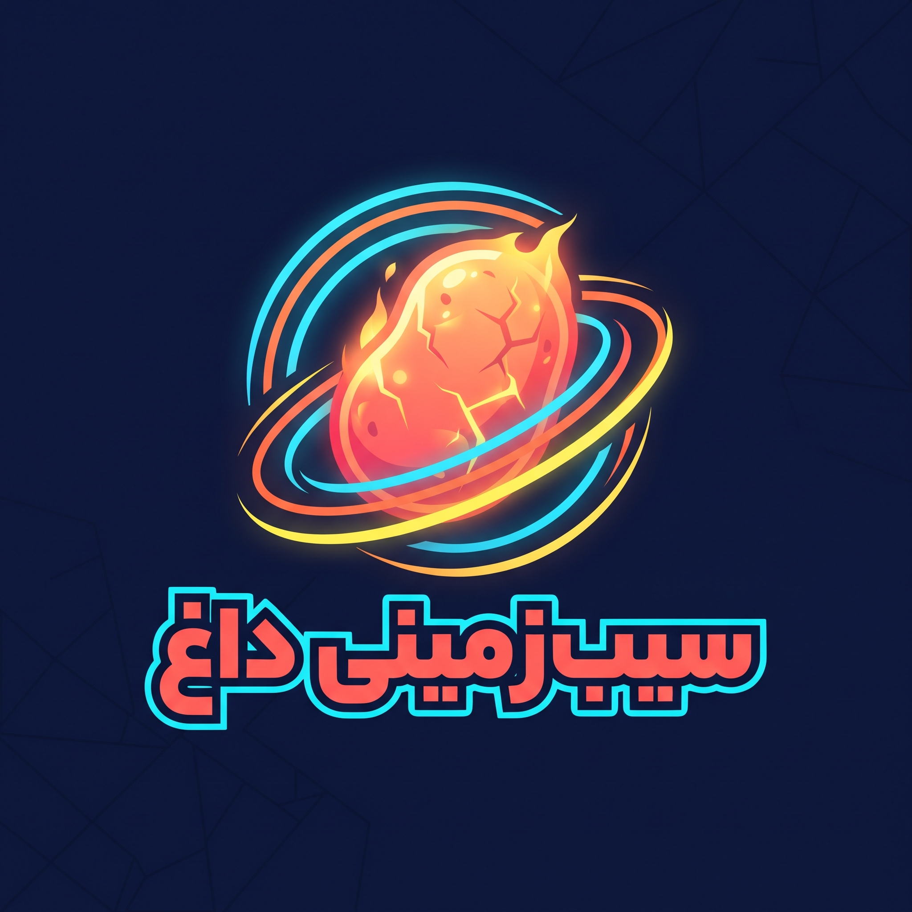

  
  <h1>سیب‌زمینی داغ (Hot Potato)</h1>
  
<strong>توضیح بده، سریع رد کن و نذار سیب‌زمینی داغ تو دستت بترکه!</strong>

  

    <a href="https://geek12b.github.io/HotPotato/"><strong>▶️ شروع بازی آنلاین در مرورگر گوشی (بدون نیاز به نصب)</strong></a>
  

---

## این بازی چیست؟
**سیب‌زمینی داغ** یک بازی گروهی و دورهمی ساده، پرهیجان و رایگان برای جمع‌های خانوادگی و دوستانه است (از **۴ تا ۲۰ نفر**). فقط کافی است یک گوشی را روشن کنید، دور هم بنشینید و قبل از تمام شدن زمان و به صدا درآمدن زنگ پایان، کلمه‌ها را توضیح دهید و گوشی را به نفر بعدی پاس بدهید!

---

## چطور بازی را باز کنیم؟ (برای همه سنین — بدون نیاز به دانش فنی)

1. **لینک بازی را باز کنید:**
   وارد آدرس زیر در مرورگر گوشی خود (Safari در آیفون یا Chrome در اندروید) شوید:
   👉 **https://geek12b.github.io/HotPotato/**
2. **صدای گوشی را باز کنید:**
   مطمئن شوید گوشی روی حالت بی‌صدا (Silent) نیست و صدا بالا است تا صدای تیک‌تاک ساعت و زنگ پایان را بشنوید.
3. **پیشنهاد برای دسترسی سریع‌تر (مثل اپلیکیشن):**
   روی گوشی خود گزینه **Share** (در آیفون) یا منوی سه‌نقطه (در اندروید) را بزنید و **Add to Home Screen** را انتخاب کنید تا آیکون **سیب‌زمینی داغ** همیشه روی صفحه اصلی گوشی شما بماند.

---

## روش بازی در ۳ قدم ساده

### قدم اول: چیدن دایره و تنظیم بازی
* بازیکنان به صورت دایره‌ای دور هم می‌نشینند.
* افراد روبه‌روی هم در دایره، **هم‌تیمی** هستند (مثلاً در جمع ۱۲ نفره، نفر ۱ و ۷ یک تیم هستند).
* در صفحه اول بازی، **تعداد بازیکنان**، **تعداد راندها**، **زمان هر راند**، **دسته‌بندی کلمات** (خوراکی‌ها، اشیاء، شغل‌ها، مکان‌ها، حیوانات یا همه دسته‌بندی‌ها) و **درجه سختی** را انتخاب کنید و در صورت تمایل اسم بازیکنان را بنویسید.
* دکمه **شروع بازی** را بزنید.

### قدم دوم: توضیح بده و گوشی را پاس بده!
* در نوبت هر بازیکن، دکمه نمایش کلمه را بزنید تا کلمه مخفی نمایش داده شود.
* باید طوری کلمه را توضیح دهید که **هم‌تیمی روبه‌رویی شما** آن را حدس بزند (بدون گفتن خود کلمه یا هم‌ریشه‌های آن).
* به محض اینکه هم‌تیمی کلمه را درست گفت، دکمه **حدس درست / نفر بعدی** را بزنید و گوشی را به **نفر کناری در دایره** بدهید.
* تایمر بدون توقف ادامه دارد و هر چه سرعت شما بیشتر باشد، زمان کمتری به پای تیم شما ثبت می‌شود!

### قدم سوم: زنگ پایان و امتیازدهی
* وقتی زمان راند رو به اتمام است، صدای تیک‌تاک تندتر می‌شود و در پایان **زنگ (Buzzer)** به صدا در می‌آید.
* **تیمی که در لحظه زنگ گوشی را در دست داشته باشد، جریمه می‌شود** و تیم‌هایی که سریع‌تر کلمات را حدس زده‌اند امتیاز بیشتری می‌گیرند.
* در پایان هر راند، جدول امتیازات و نمودار پیشرفت هر تیم نمایش داده می‌شود و در پایان آخرین راند، **تیم قهرمان** معرفی می‌گردد.

---

## ویژگی‌های بازی
* **کاملاً رایگان و بدون نیاز به نصب:** مستقیم روی مرورگر موبایل اجرا می‌شود.
* **بانک ۲۵۰۰ کلمه متنوع:** در ۵ دسته‌بندی مختلف با انتخاب تصادفی بر اساس تاریخ و زمان لحظه شروع بازی تا هیچ دو بازی تکراری نباشند.
* **طراحی ساده و خوانا:** دکمه‌های بزرگ و واضح برای استفاده راحت کودکان، بزرگسالان و سالمندان.
* **شروع تازه با رفرش صفحه:** با هر بار رفرش کردن صفحه، بازی به صورت تمیز از ابتدا آماده می‌شود.

---

## نسخه‌های بعدی (Roadmap)
* افزودن نسخه **انگلیسی (English)**
* افزودن نسخه **اسپانیایی (Español)**
